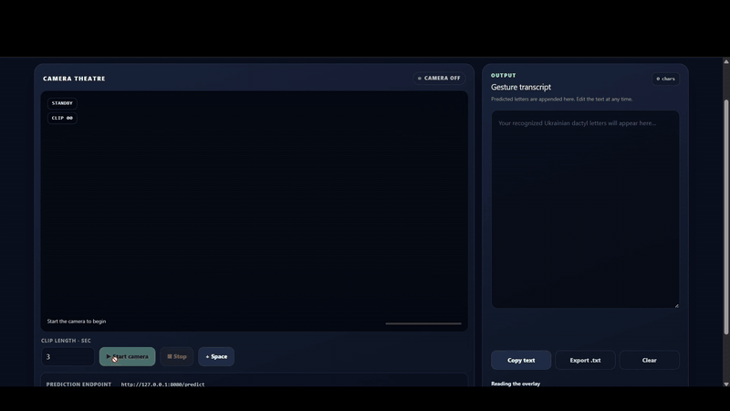
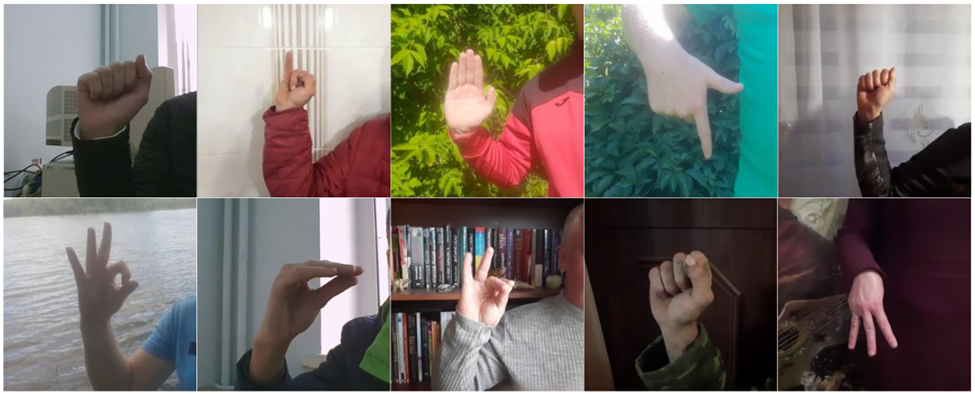
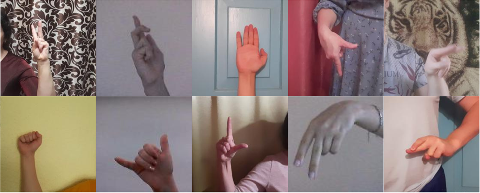
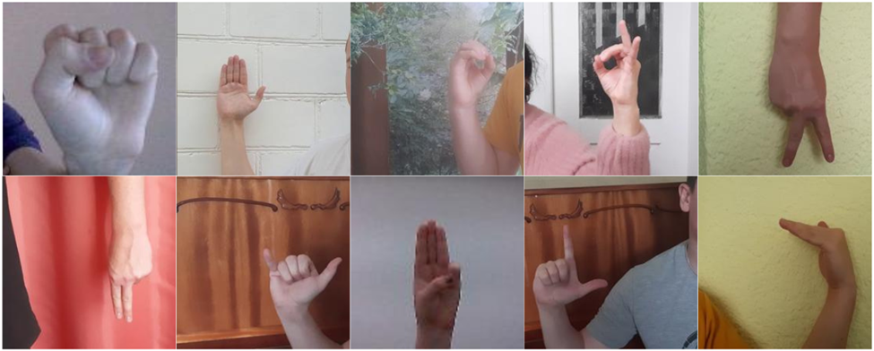
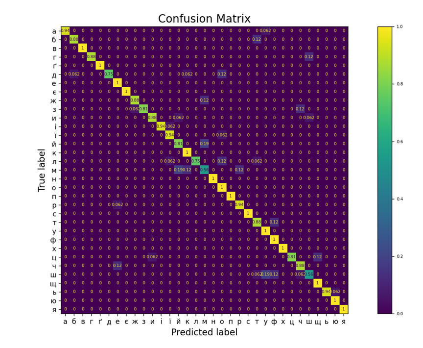
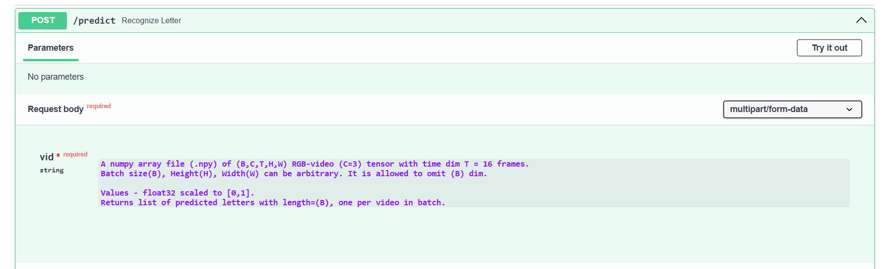

## Contents
- [Demo](#demo)
- [Brief description](#brief-description)
- [Illustrations](#illustrations)
- [Quality reports](#quality-reports)
- [Installation](#installation)
- [Usage](#usage)
- [Results](#results)

## Demo

  

## Brief description
This gesture classifier is the result of the first successful train|validation|test cycle i`ve ever made. For first (2D-conv) versions, see deprecated/. Its first version was also a part of my bachelors graduation work presented in deprecated/bachelors_diploma.pdf file - further descriptions of that one can be found there.
The second version is trained for all the alphabet including dynamic gestures, leverages completely different architecture - Expand3D (X3D-M) - with kinetics-400 backbone:

*Feichtenhofer, C. (2020). X3D: Expanding architectures for efficient video recognition. Proceedings of the IEEE/CVF Conference on Computer Vision and Pattern Recognition (CVPR), 203–213. https://doi.org/10.1109/CVPR42600.2020.00028*

The dataset can be found at: https://doi.org/10.5281/zenodo.17618405

## Illustrations

1) training set (1st-of-16 frame examples):

    

2) validation set (1st-of-16 frame examples):

    

3) test set (1st-of-16 frame examples):

    

## Quality reports

Confusion Matrix built for test set:

    

SK-learn classification report on test set:

| Class | Precision | Recall | F1-score | Support |
|-------|-----------|--------|----------|---------|
| а | 1.00 | 0.94 | 0.97 | 16 |
| б | 0.93 | 0.88 | 0.90 | 16 |
| в | 1.00 | 1.00 | 1.00 | 16 |
| г | 1.00 | 0.88 | 0.93 | 16 |
| ґ | 1.00 | 1.00 | 1.00 | 16 |
| д | 1.00 | 0.75 | 0.86 | 16 |
| е | 0.84 | 1.00 | 0.91 | 16 |
| є | 1.00 | 1.00 | 1.00 | 16 |
| ж | 0.93 | 0.88 | 0.90 | 16 |
| з | 1.00 | 0.81 | 0.90 | 16 |
| и | 0.93 | 0.88 | 0.90 | 16 |
| і | 1.00 | 0.94 | 0.97 | 16 |
| ї | 0.88 | 0.94 | 0.91 | 16 |
| й | 0.76 | 0.81 | 0.79 | 16 |
| к | 0.84 | 1.00 | 0.91 | 16 |
| л | 1.00 | 0.75 | 0.86 | 16 |
| м | 0.64 | 0.56 | 0.60 | 16 |
| н | 1.00 | 1.00 | 1.00 | 16 |
| о | 0.76 | 1.00 | 0.86 | 16 |
| п | 1.00 | 1.00 | 1.00 | 16 |
| р | 0.88 | 0.94 | 0.91 | 16 |
| с | 1.00 | 1.00 | 1.00 | 16 |
| т | 0.78 | 0.88 | 0.82 | 16 |
| у | 0.80 | 1.00 | 0.89 | 16 |
| ф | 0.80 | 1.00 | 0.89 | 16 |
| х | 1.00 | 1.00 | 1.00 | 16 |
| ц | 1.00 | 0.81 | 0.90 | 16 |
| ч | 0.82 | 0.88 | 0.85 | 16 |
| ш | 0.75 | 0.56 | 0.64 | 16 |
| щ | 0.89 | 1.00 | 0.94 | 16 |
| ь | 1.00 | 0.94 | 0.97 | 16 |
| ю | 0.94 | 1.00 | 0.97 | 16 |
| я | 1.00 | 1.00 | 1.00 | 16 |
|-------|-----------|--------|----------|---------|
| **accuracy** | - | - | 0.91 | 528 |
| **macro avg** | 0.92 | 0.91 | 0.91 | 528 |
| **weighted avg** | 0.92 | 0.91 | 0.91 | 528 |

## Inference
The best checkpoint version was exported to ONNX. Inference pipeline was implemented around it, including FastAPI endpoint.
Gateway docs are generated with FastApi and can be found at /docs endpoint:

    

Resulting app was dockerized, with image pushed to Docker Hub:
https://hub.docker.com/repository/docker/mihzad/gesture-classifier/general

Also, a simple frontend (see ./inference_app/frontend for src) was generated, it does all the preprocessing and allows to recognize letters right away. See Demo for the work results.

